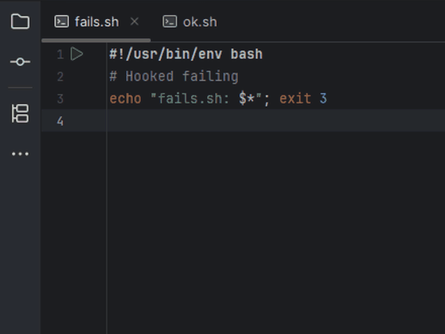
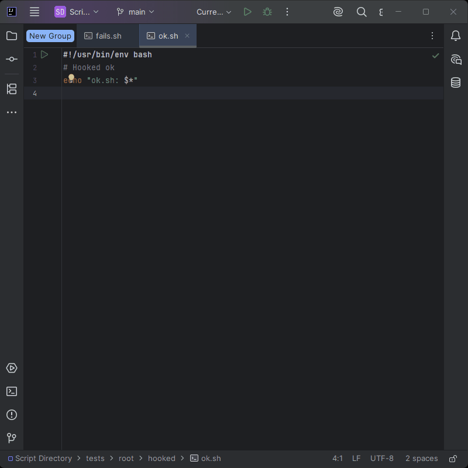
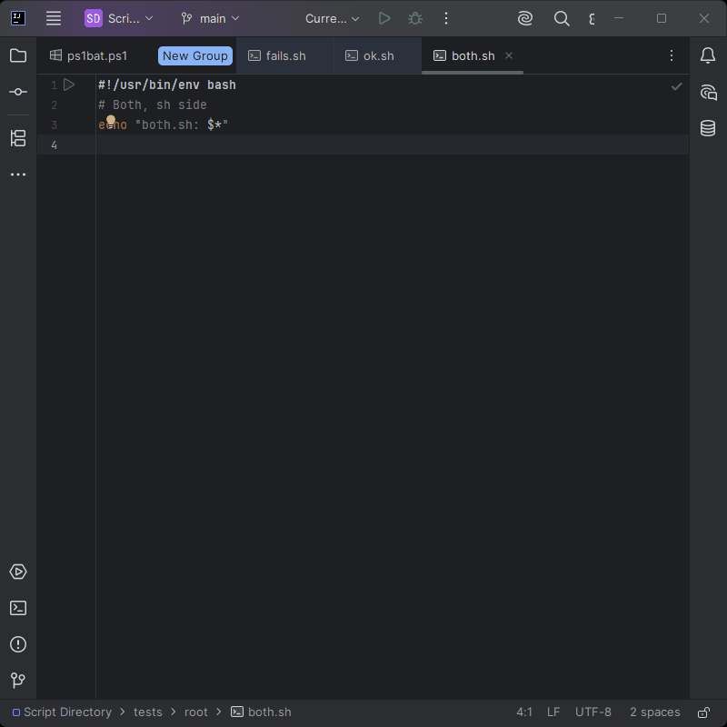
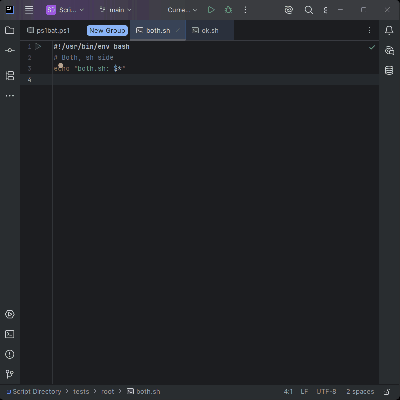
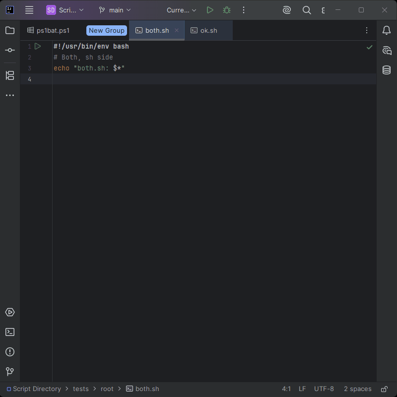
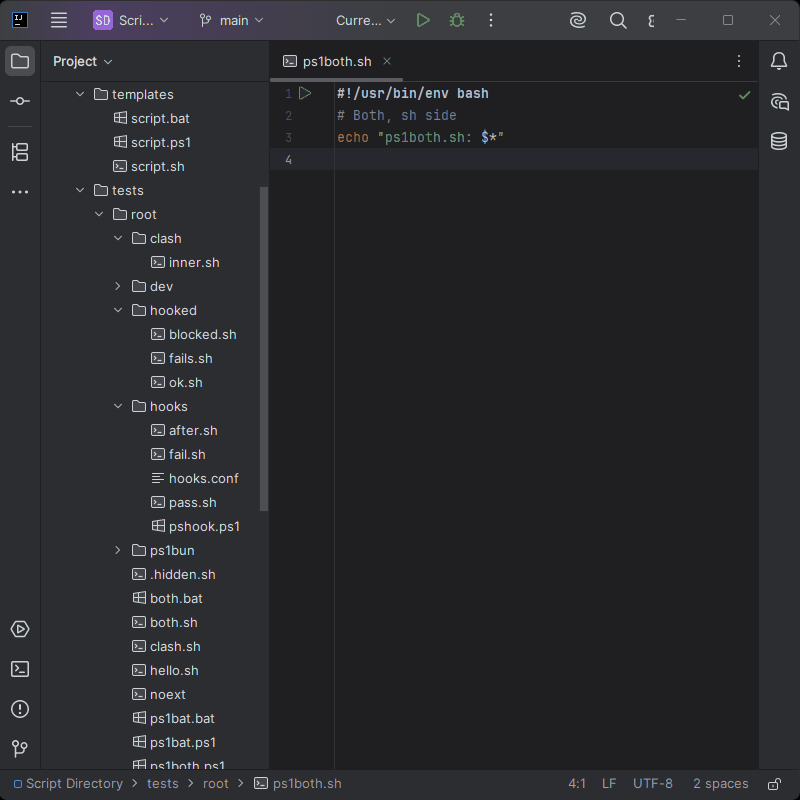

# Better Editor Tabs

Chrome-style tab groups for the editor tab bar in JetBrains IDEs.

## Features

<table>
  <tr>
    <td width="50%" valign="top">
      <br>
      <b>🏷️ Tab groups</b><br>
      Group editor tabs under a named, coloured header from the tab's context menu.
    </td>
    <td width="50%" valign="top">
      <br>
      <b>📂 Collapse and expand</b><br>
      Click a group's header to hide its tabs and show them again.
    </td>
  </tr>
  <tr>
    <td width="50%" valign="top">
      <br>
      <b>✋ Drag and drop</b><br>
      Drag tabs into and out of groups, or drag a whole group by its header.
    </td>
    <td width="50%" valign="top">
      <br>
      <b>🪟 Splits and windows</b><br>
      Move or copy groups between splits and windows; a group stays linked across splits.
    </td>
  </tr>
  <tr>
    <td width="50%" valign="top">
      <br>
      <b>📦 Stash and restore</b><br>
      Stash a group to close its tabs, then bring it back later with <i>Restore Tab Group…</i>.
    </td>
    <td width="50%" valign="top">
      <br>
      <b>⚡ Auto-group rules</b><br>
      New files join a group automatically by module, directory or regex.
    </td>
  </tr>
</table>

Requires IntelliJ Platform 2026.2 or later with the New UI. Works in every JetBrains IDE.

## Build

Requirements: JDK 25 or later.

```bash
./gradlew buildPlugin
```

The plugin zip is written to `build/distributions/`. To install it, open **Settings ▸ Plugins ▸ ⚙ ▸ Install Plugin from Disk…** and pick the zip.

To try the plugin in a sandbox IDE:

```bash
./gradlew runIde
```

On Windows, use `.\gradlew.bat` instead of `./gradlew`.
